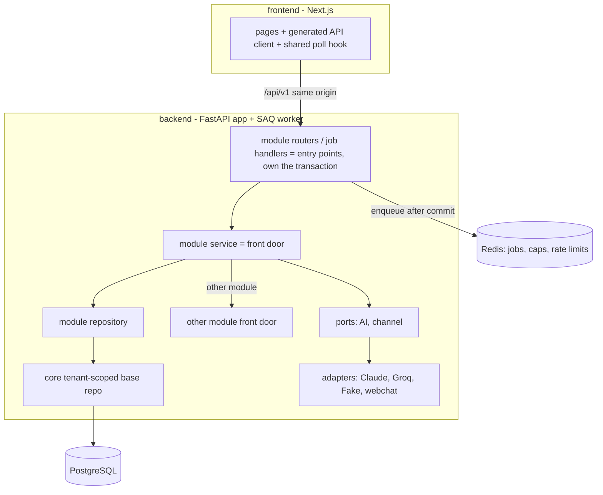
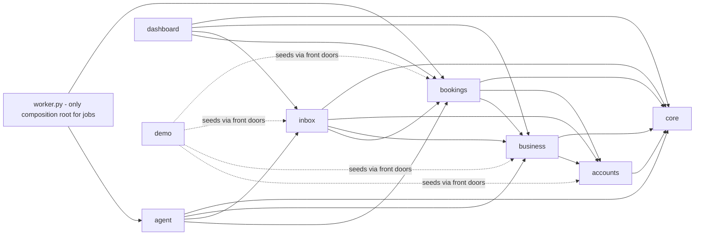
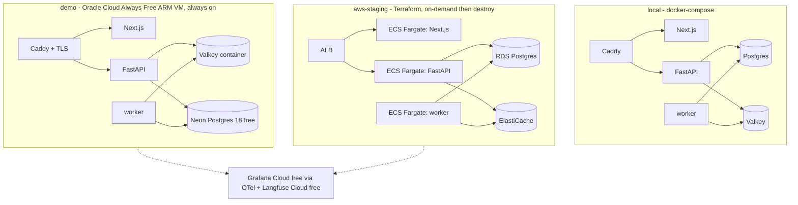
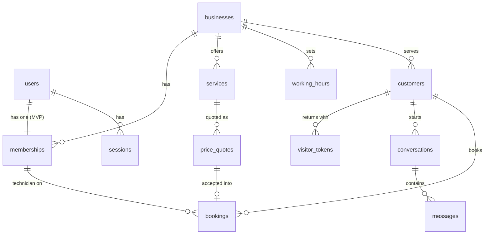

# Architecture Spine — SevaDesk MVP

## Design Paradigm

**Modular monolith.** One FastAPI app and one worker, deployed together, split into **feature modules**. Inside each module: `router → service → repository`. Only the external edges (AI provider, channels, later payments) use **ports and adapters**. Next.js renders UI only.

| Module | Owns (only it reads/writes these) | Front door (`service.py`) used by |
| --- | --- | --- |
| `core` | no business tables — DB session + unit of work, tenant context, tenant-scoped base repository, Actor, settings, telemetry + PII masking, rate limiting, error envelope, job names + enqueue helper | all modules |
| `accounts` | users, memberships (roles), sessions, invites | all (who is asking) |
| `business` | businesses, services + prices, working hours, chat slug | agent, bookings, inbox |
| `inbox` | customers, visitor tokens, conversations (+ state, seq), messages; **channel port** (webchat adapter) | agent, dashboard |
| `agent` | prompts, tool definitions, agent loop, daily cap; **AI port** (Claude, Groq, Fake adapters) | worker |
| `bookings` | bookings (+ state, `expires_at`, technician), price quotes, capacity lock, slot math, expiry | agent, inbox, dashboard |
| `dashboard` | no tables | — |
| `demo` | seed + reset command only | — |



## Invariants & Rules

### AD-1 — Feature modules with one table owner each

- **Binds:** all backend code
- **Prevents:** code placed by layer in one story and by feature in another; two modules writing one table.
- **Rule:** Backend code lives under `backend/app/modules/<module>/`. Every table has exactly one owning module (map above). A new table names its owner in the story.

### AD-2 — Cross-module access only through the front door

- **Binds:** all modules
- **Prevents:** booking or conversation rules duplicated in agent, inbox, or dashboard; ORM objects leaking across modules.
- **Rule:** A module imports another module only through its `service.py` public functions, for reads and writes. Never import another module's `repository` or `models`, or query its tables. Front doors take and return Pydantic DTOs, never ORM objects. Calls are synchronous; no event bus in the MVP. Dependency direction (diagram below) is enforced in CI by `import-linter`.

### AD-3 — Tenant scoping is automatic and server-derived

- **Binds:** FR-11, NFR-1, every repository, endpoint, job, and Redis key
- **Prevents:** a forgotten `business_id` filter; a client choosing its tenant; jobs or scripts running without a tenant.
- **Rule:** Every repository extends the `core` tenant-scoped base repository, which adds the `business_id` filter to every query and sets it on every insert; repository methods never accept `business_id` from callers. Tenant context is set only from: (a) staff session → membership; (b) public visitor token / chat slug (AD-16); (c) the `business_id` in a job payload; (d) one audited `system_scope` with an allow-list of callers (login, sign-up and invite-accept lookups in `accounts`; cron fan-out; demo seed/reset; evals). A cross-tenant cron only enqueues one job per Business. Global tables: `users`, `businesses`, `sessions`. Redis keys start with purpose, then `business_id` (e.g. `cap:<business_id>:2026-11-01`). FR-11 isolation tests run on every PR and cover write paths too.
- **Database second guard:** every tenant table has `UNIQUE (business_id, id)`. Every link between tenant tables is a composite foreign key `(business_id, <x>_id)`, so the database refuses a row in one Business that points at a row in another. Raw `text()` SQL is allowed only in `core`, because the automatic tenant filter does not apply to it.

### AD-4 — One Business per user; roles as a set on the membership

- **Binds:** FR-7–FR-10, FR-17, FR-26, `accounts`, `bookings`
- **Prevents:** a solo Owner not counted as Technician; role checks written differently per story; bookings pointing at a deleted person.
- **Rule:** `memberships(user_id, business_id, roles, is_active)`; `roles` is a set of `owner | staff | technician`; a unique constraint on `user_id` keeps one Business per user in the MVP. Memberships are deactivated, never deleted. Bookings reference `technician_membership_id`. Only `accounts` computes "active Technicians". Services receive an `Actor` (user_id, membership_id, business_id, roles) and check permission with one `require_roles` helper; a Technician-only Actor sees only their own Bookings.

### AD-5 — Server-side sessions in an httpOnly cookie

- **Binds:** FR-8, FR-9, FR-10, NFR-5
- **Prevents:** mixed auth schemes; access that survives logout or removal.
- **Rule:** Login creates a random opaque token stored server-side by `accounts`; the browser holds it in an `httpOnly`, `Secure`, `SameSite=Lax` cookie. Each request resolves session → Actor. Logout and member deactivation delete sessions at once. Passwords are hashed with Argon2id. No JWT. Role checks happen in the backend only. Every state-changing request (`POST`, `PUT`, `PATCH`, `DELETE`) must carry an `Origin` header that matches the app origin (CSRF guard); no state changes on `GET`.

### AD-6 — One origin everywhere

- **Binds:** deployment, auth, frontend, rate limiting
- **Prevents:** cross-site cookie failures, per-environment CORS drift, rate limits seeing only the proxy IP.
- **Rule:** One front door serves both apps: `/api/*` → FastAPI (health at `/api/health` and `/api/health/worker`), everything else → Next.js. Local and demo: Caddy in docker-compose. AWS: one ALB with path routing. No CORS allow-list. The client IP comes only from the trusted proxy's forwarded header.

### AD-7 — Agent replies run in the worker; clients poll one snapshot

- **Binds:** FR-15, FR-18a, FR-22, FR-24, FR-25, NFR-3
- **Prevents:** AI calls inside web requests; skipped messages; booking status that never reaches the Chat Page; two agent replies at once.
- **Rule:**
  - Each Message gets a per-Conversation increasing `seq`, set under a row lock. Clients pass an opaque cursor.
  - Sending a Message saves it and, after commit, enqueues `agent_reply` with job key `<conversation_id>:<customer seq>`, carrying `business_id`, `conversation_id`, that `seq`, and `traceparent`. The web request returns at once.
  - **No skipped messages.** A Redis lock per Conversation (TTL 30 s) lets only one `agent_reply` run at a time. The job answers every Customer Message up to its `seq`. Before saving, it checks for a newer Customer Message; if one exists, it drops its own reply and the newer job answers all of them. It saves the Agent Message only if the Conversation is still in `agent` state.
  - **Turn deadline.** One agent turn has a 9 s deadline from job start and at most 4 tool calls. Each AI call gets only the time left; there is no auto-retry of a failed call. On deadline or failure, the worker writes the FR-22 message and sets Handoff. Queue wait time is logged so NFR-3 can be measured.
  - **No stuck replies.** `reply_pending` is derived, never stored: last Customer `seq` > last reply `seq` and state is `agent`. Every pending reply ends within 30 s in an Agent Message or the FR-22 message; a SAQ job timeout plus an aborted-job handler guarantee this when the worker crashes.
  - Chat Page and Inbox poll one endpoint shape. It returns new Messages plus a snapshot: `conversation_state`, `reply_pending`, and the Booking status. `inbox` composes the Booking status by calling `bookings`.
  - **Cheap polls.** After each commit that changes a Conversation or its Booking, a Redis counter `ver:<business_id>:<conversation_id>` goes up. A poll whose client version matches the counter returns "no change" without touching Postgres.
  - Polling runs every 1–2 s while a reply is pending, never more than 5 s apart while the tab is visible, and stops when the tab is hidden. Poll endpoints are rate-limited.

### AD-8 — The agent gets facts only from tools; money never comes from the model

- **Binds:** FR-16, FR-16a, FR-17, FR-18, FR-19, FR-20, FR-21, NFR-2
- **Prevents:** invented Prices or Slots; a prompt-injected price; the agent writing bookings directly.
- **Rule:**
  - The agent reads Services, Working Hours, and free Slots, and acts, only through tools whose handlers call other modules' front doors. It runs tool calls one at a time.
  - Price flow: `bookings.quote_price(service_id)` records the shown Price as a quote, tied to one Conversation, with its own expiry. The server shows it as an "Accept ₹X" chip (`actions[]`) that carries the `quote_id`. **The Customer accepts only by tapping that chip;** the server records the acceptance directly, with no tool call. The LLM can never mark a quote accepted. `bookings.create_request(quote_id, slot)` refuses a quote that is not accepted, is expired, or belongs to another Conversation, and takes the price from the quote. The LLM never supplies an amount.
  - **Prices and Slots appear only in server-built chips or cards** made from tool results, never in the reply text.
  - Tool schemas are defined once in `agent`. The AI port translates them per provider.
  - Before sending, a post-check verifies that the reply text contains no money amounts and no times or dates of Slots (in any script or wording). On failure: regenerate the text once (tools are not re-run), then hand off.
  - Message shape: `author_type` (`customer | agent | user | system`), `author_membership_id`, `body`, `lang`, `client_message_id` (idempotent send), `actions[]` (UI chips).

### AD-9 — One booking write path behind a bookings-owned capacity lock

- **Binds:** FR-17, FR-18, FR-18a, FR-25, FR-27, `bookings`
- **Prevents:** two Customers taking the last Slot; a Technician assigned twice; expiry racing a confirm.
- **Rule:**
  - Every write that takes, moves, or frees capacity (create request, manual booking, change Slot, confirm with Technician, decline, cancel, expire) runs in `bookings`.
  - Each one first takes the transaction-level advisory lock `pg_advisory_xact_lock(<bookings lock namespace>, <hash of business_id>)` (never a session-level lock). Then it recounts overlapping live `requested` + `confirmed` Bookings against active Technicians. On assign or confirm, it also checks that the Technician has no overlapping confirmed Booking.
  - Every state change is a guarded `UPDATE … WHERE state = :from`.
  - `UNIQUE (bookings.quote_id)`: one quote makes at most one Booking, so a repeated `create_request` cannot double-book.
  - **Anti-hoarding:** at most one open request per Conversation, and at most a small fixed number of open requests per visitor token and per client IP. This check runs inside the lock.
  - A request stores `expires_at`. "Expired" is computed, not written, on read: `state = 'requested' AND expires_at < now()` counts as expired. One `bookings` repository function holds this rule, and every count and read uses it. An hourly sweep persists the `expired` state.
  - A taken Slot raises `SlotUnavailable`. The agent turns it into new offers.

### AD-10 — Owned state machines

- **Binds:** FR-18a, FR-21, FR-23–FR-25, FR-27
- **Prevents:** screens or the worker setting states their own way.
- **Rule:** `inbox` owns Conversation state: `agent | handoff | closed`, changed only by named front-door functions (`start_handoff`, `end_handoff`, `close`). A User reply calls `start_handoff`. The Inbox "Booking Request" badge is derived from the Booking status, not stored. `bookings` owns Booking state: `requested → confirmed | declined | expired`, `confirmed → completed | cancelled`; only `bookings` functions change it (AD-9).

### AD-11 — Swappable providers behind ports

- **Binds:** NFR-7, NFR-9, `agent`, `inbox`, later payments
- **Prevents:** provider SDK calls spreading into business logic; real data sent to Groq.
- **Rule:** Only adapter files import a provider SDK (`anthropic`, `openai` for Groq, later WhatsApp/SMS/Razorpay). The provider is chosen by env var. The Groq adapter refuses to start outside `local`/`dev`. Claude runs CI evals and the demo. A deterministic `FakeAI` adapter serves unit, integration, and E2E tests.

### AD-12 — Every AI call is traced and capped

- **Binds:** NFR-4, NFR-7
- **Prevents:** untracked cost; evals unable to compare prompt versions.
- **Rule:** Prompts are versioned files in `agent/prompts/` with a version id. Each AI call records prompt version, model, tokens, cost, and latency in Langfuse, linked to the OTel trace. Before each call the worker runs an atomic `INCR` on the per-Business per-day Redis counter, then compares; over the cap → Handoff. (Never read-then-call.)

### AD-13 — Personal data is masked at one point and deleted by owners

- **Binds:** NFR-8
- **Prevents:** phone numbers or addresses in logs; partial deletes.
- **Rule:** One masking function in `core` is applied to logs, traces, and Langfuse payloads. "Delete Customer" is orchestrated by `inbox` in one transaction: first `bookings.delete_for_customer`, then its own rows.

### AD-14 — The OpenAPI schema is the only API contract

- **Binds:** frontend, all routers
- **Prevents:** frontend and backend disagreeing on fields or errors; four screens fetching data four ways.
- **Rule:** Routes live under `/api/v1`, JSON only. Errors use one envelope: `{"error": {"code": "...", "message": "..."}}`. The frontend TypeScript client is generated from FastAPI's OpenAPI schema (`openapi-typescript` + `openapi-fetch`), never hand-written. Polling uses one shared hook; no other data-fetching library in the MVP. Next.js has no own data store, no API routes with logic, and no direct DB access.

### AD-15 — The entry point owns the transaction

- **Binds:** all routers, job handlers, CLI commands, services
- **Prevents:** nested commits; locks held during AI calls; jobs that run before their data exists; lock-order deadlocks.
- **Rule:** The entry point (router dependency, job handler, CLI command) opens and commits the one DB transaction; services never commit. No AI call and no job enqueue while a transaction is open; enqueue after commit. The capacity lock (AD-9) is always the first lock taken.
- **Agent jobs** cannot hold one transaction across AI calls. They run one short transaction per tool call, plus one for the final save. Every write tool is idempotent (calling it twice has the effect of calling it once). If the final reply fails after a tool committed, the Booking stays and the poll snapshot shows it.
- **Lock order across modules:** in any flow where `inbox` calls `bookings` (phone-in booking, Customer delete), `inbox` calls `bookings` before it writes its own rows. Each such flow has one integration test.

### AD-16 — Public chat identity is a server-side visitor token

- **Binds:** FR-14, FR-15, NFR-5, NFR-8
- **Prevents:** reading another Customer's chat by guessing an id; two ways to "return to the same chat".
- **Rule:** The first visit to a chat slug sets a random visitor token in an `httpOnly` cookie. `inbox` stores only its hash and resolves token → Customer and Conversation on the server. Public endpoints never accept a `conversation_id`. A Customer is linked by `(business_id, phone)` once the agent collects the phone number. **This link is for the Owner's view only.** A visitor sees only Conversations and Bookings made with their own visitor token. Phone matching never shows earlier chats, addresses, or Bookings to a visitor (no OTP in the MVP).

### AD-17 — Evals run the real agent loop and gate merges

- **Binds:** FR-5, FR-30, NFR-2, NFR-10
- **Prevents:** evals that test a different path than production; flaky or costly CI.
- **Rule:** Evals run the real agent loop against a seeded Testcontainers DB. The smoke set runs on every PR with Claude's cheap model; the full set runs nightly or on demand. A baseline score file lives in the repo. Gates: any invented Price or Slot, or any Booking Request without an accepted Price, blocks the merge (hard zero, SM-3); other metrics block only when they drop more than a fixed tolerance below baseline. Evals run at temperature 0, and smoke cases run twice. Code checks run first; an LLM judge scores tone. The Claude key is never exposed to fork PRs.

### Dependency direction



Arrows point only to front doors. `core` depends on no module. No cycles. `bookings` never imports `inbox`: it stores `customer_id` and a nullable `conversation_id` (phone-in bookings have none) as plain ids. Flows that span both (Chat Page status, Inbox rows, phone-in booking, Customer delete) are composed by `inbox` calling `bookings`. Modules enqueue jobs by name through `core`; only `worker.py` imports job handlers.

## Consistency Conventions

| Concern | Convention |
| --- | --- |
| Module files | `router.py`, `service.py` (front door), `repository.py`, `models.py` (SQLAlchemy), `schemas.py` (Pydantic DTOs) per module |
| Naming | Python `snake_case`; tables plural `snake_case`; JSON fields `snake_case` as the API sends them |
| IDs | UUIDv7 primary keys on every table |
| Time | `timestamptz` in UTC; each Business has a timezone (default `Asia/Kolkata`); slot math and display use it |
| Money | integer paise in fields named `*_paise`; never floats |
| Errors | typed domain exceptions in services, mapped once in `core` to the error envelope |
| Config | env vars only, read through one `pydantic-settings` object; no secrets in code or images |
| Migrations | one Alembic history; CI fails on more than one head; the pipeline runs `alembic upgrade head` before deploy |
| Logging | structured JSON with request id and trace id via OpenTelemetry; PII masked (AD-13) |
| Rate limits | Redis counters keyed by client IP (AD-6) and by Conversation; on log-in and all public chat endpoints |
| Tests | unit: pytest / Vitest; integration: Testcontainers Postgres + Redis; E2E: Playwright for UJ-1–UJ-3 with `FakeAI`; tenant-isolation suite on every PR; agent-job concurrency test (two Messages 1 s apart → one reply that covers both); Chat Page bundle-size check (≤ 200 KB) in CI |

## Stack

| Name | Version |
| --- | --- |
| Python | 3.14 |
| FastAPI | 0.162.0 |
| Uvicorn | 0.54.0 |
| SQLAlchemy | 2.1.6 |
| Alembic | 1.20.1 |
| Pydantic | 2.14.2 |
| pydantic-settings | 2.16.2 |
| psycopg | 3.3.6 |
| SAQ (worker on Redis) | 0.26.5 |
| redis-py | 7.4.1 |
| pwdlib (Argon2) | 0.3.1 |
| anthropic | 2.3.0 |
| openai (Groq client) | 3.42.0 |
| langfuse | 5.1.0 |
| opentelemetry-sdk | 1.45.2 |
| import-linter | 2.15 |
| pytest | 9.2.0 |
| testcontainers | 4.15.0 |
| PostgreSQL | 18 |
| Valkey (Redis-compatible) | 9.0 |
| Node.js | 24 LTS |
| Next.js | 16.4.3 |
| React | 19.3.1 |
| TypeScript | 5.9.3 |
| Tailwind CSS | 4.3.3 |
| openapi-typescript | 7.13.0 |
| openapi-fetch | 0.17.0 |
| Vitest | 5.0.5 |
| Playwright | 1.64.1 |
| Caddy | 2.11.7 |
| Terraform | 1.17.1 |

## Structural Seed

```text
seva-desk/
  backend/
    app/
      main.py              # FastAPI app, mounts module routers
      worker.py            # SAQ worker: agent_reply, expire sweep (fan-out), demo reset
      core/                # db + unit of work, tenant context, base repo, actor, settings, telemetry, masking, jobs, errors
      modules/
        accounts/ business/ inbox/ agent/ bookings/ dashboard/ demo/
    migrations/            # Alembic
    tests/                 # unit, integration, isolation
  frontend/                # Next.js; src/api/ holds the generated client + poll hook
  evals/                   # golden dataset, baseline score, runner (CI gate)
  infra/
    compose/               # docker-compose + Caddyfile (local, demo)
    terraform/             # AWS staging (on-demand)
  .github/workflows/
```

### Deployment & environments



- Images are built once per commit for `amd64` and `arm64` and pushed to GHCR; every environment runs the same images; only env vars change.
- Pipeline (GitHub Actions): lint + import-linter → tests (incl. isolation) → evals smoke set → build images → migrate + deploy demo + demo reset → manual approval → aws-staging.
- Operations: Grafana alerts on API error rate, worker health, and daily agent cost; AWS budget alert at $5; Anthropic monthly limit.
- AWS: public subnets with strict security groups, no NAT Gateway; secrets in Secrets Manager; `terraform destroy` after each session. Demo secrets live in an env file on the server, outside Git.
- Idle-cost guard: the worker polls Valkey, not Postgres; the expiry sweep runs hourly; polls with no change stop at Valkey (AD-7), so Neon can sleep when idle.
- Oracle account: stays **Always Free** (decided 2026-11-06, AR-24; replaces the 2026-11-04 PAYG choice: the PAYG card check needs a ~₹10,000 hold the card declined). Risk accepted: Oracle can reclaim an idle free VM; recovery = new VM + `infra/demo/README.md` runbook. Budget alert at $1.
- Demo domain: `<ip-with-dashes>.sslip.io` (no DNS account; it changes if the VM IP changes).
- Demo placement: the Neon region is the closest one to the Oracle VM region (both in or near India) to keep query round trips short. The demo Valkey container has AOF persistence on, so queued jobs survive a restart.

### Core entities



## Capability → Architecture Map

| Capability / Area | Lives in | Governed by |
| --- | --- | --- |
| FR-1–FR-6 walking skeleton, CI, deploy | `core`, `infra/`, `.github/`, `evals/` | AD-6, AD-15, AD-17, conventions |
| FR-7–FR-11 accounts, roles, isolation | `accounts`, `core` | AD-3, AD-4, AD-5 |
| FR-12–FR-14 services, hours, chat link | `business`, `inbox` | AD-1, AD-3, AD-16 |
| FR-15–FR-22 chat + agent | `inbox`, `agent`, worker | AD-7, AD-8, AD-10, AD-11, AD-12, AD-16 |
| FR-23–FR-24 inbox | `inbox` | AD-7, AD-10 |
| FR-25–FR-27 bookings, calendar | `bookings` | AD-4, AD-9, AD-10, AD-15 |
| FR-28 dashboard | `dashboard` | AD-2 |
| FR-29 demo mode | `demo` | AD-2, AD-3 |
| FR-30 golden dataset | `evals/` | AD-17 |
| FR-31 landing page | `frontend/` | AD-6, AD-14 |
| NFR-3 response time | worker, poll hook | AD-7 |
| NFR-5 security | `core`, `accounts`, `inbox` | AD-3, AD-5, AD-6, AD-16 |
| NFR-6 mobile, 200 KB Chat Page | `frontend/` | AD-14, CI bundle check |
| NFR-7 cost | `agent`, infra | AD-11, AD-12, idle-cost guard |
| NFR-8 DPDP | all modules | AD-13, AD-16 |

## Deferred

- **Postgres Row-Level Security** — a second tenant lock; add after AD-3 is proven by the isolation suite.
- **Exclusion constraint on technician time ranges** — optional second guard behind AD-9.
- **SSE / WebSockets** — only if polling cannot meet NFR-3 or the 5-second updates.
- **Event bus between modules** — revisit for P4 reminders and campaigns.
- **Separate `customers` module** — revisit when P4 (AMC, campaigns) grows.
- **Multi-business users** — drop the unique constraint on `memberships.user_id` when needed.
- **Payments port and adapters** — P2 (mock) and P3 (Razorpay).
- **WhatsApp and SMS adapters** — P3, official API only.
- **UI component kit** — first frontend story; must not add a data-fetching library (AD-14).
- **Exact Claude and Groq model ids** — set by env per environment in the agent story.
- **Slot length and step** — decided in the slot-math story; only `bookings` computes Slots (AD-9).
- **Exact numbers** — open-request limit per visitor/IP (AD-9), quote expiry (AD-8), and eval tolerance (AD-17) are set in their stories, as fixed constants.
- **OTP phone verification** — P3, with the SMS adapter; until then AD-16's view-only link applies.
- **TypeScript 7** — after openapi-typescript supports it (issue #2841).

## Open Questions

- None open. (Oracle account tier: decided 2026-11-06, see Deployment & environments.)
