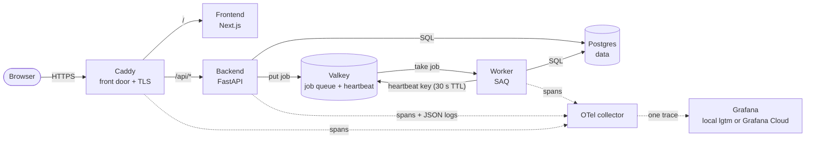
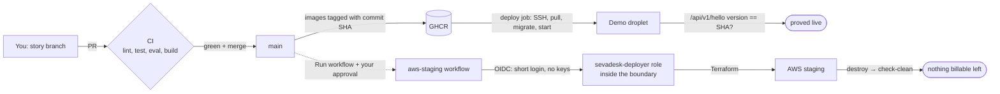

# SevaDesk architecture map (end of Epic 1)

Epic 1 built the **skeleton**: every part exists and talks to the others, but the app only says
"Namaste". Epics 2+ put real features into this skeleton.

## 1. One request, end to end (runtime)

- The **job** carries a `traceparent` label, so the worker's work joins the same trace as the request.
- `/api/health` asks Postgres, Valkey, and the worker heartbeat key. If one is missing, it answers 503.

## 2. Where the same app runs

| Place | How it starts | Postgres | TLS | Cost |
|---|---|---|---|---|
| Laptop | `docker compose up` (infra/compose) | container | Caddy, local | $0 |
| Demo (DigitalOcean droplet) | CI after every merge to main (infra/demo) | Neon (cloud) | Caddy + sslip.io | $12/month |
| AWS staging | `deploy.sh` / approved workflow (infra/terraform) | RDS | none (HTTP via ALB) | cents per hour, then `destroy.sh` |

On AWS the parts change names but keep their jobs: **ALB** = Caddy, **ECS Fargate** = the three
containers, **RDS** = Postgres, **ElastiCache** = Valkey, **Secrets Manager** holds `DATABASE_URL`.

## 3. How code reaches the world (delivery)

## 4. Safety rails built in Epic 1

| Rail | Stops what |
|---|---|
| Branch protection + CI | broken code reaching main |
| Eval harness (exit 0/1/2) | the agent's answers getting worse without anyone noticing |
| Version check after deploy | "deployed" when the old code still runs |
| PII masking in logs | phone numbers and similar data in logs |
| OIDC + approval + boundary | stolen keys; unapproved AWS changes; a role that grows into an admin |
| `check-clean.sh` + $5 budget | a forgotten AWS bill |
