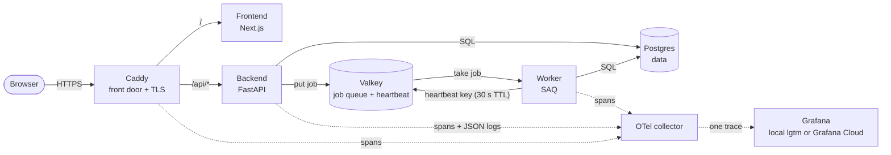
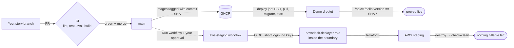
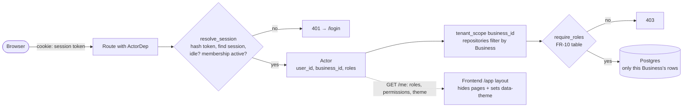
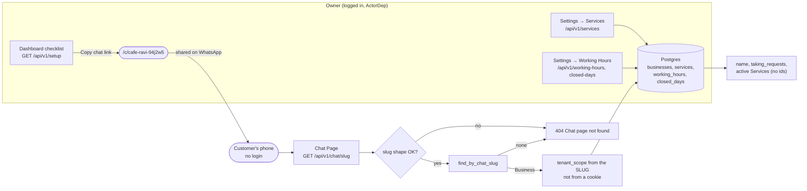

# SevaDesk architecture map (end of Epic 3)

Epic 1 built the **skeleton**: every part exists and talks to the others, but the app only says
"Namaste". Epics 2+ put real features into this skeleton.

## 1. One request, end to end (runtime)

- The **job** carries a `traceparent` label, so the worker's work joins the same trace as the request.
- `/api/health` asks Postgres, Valkey, and the worker heartbeat key. If one is missing, it answers 503.

## 2. Where the same app runs

| Place | How it starts | Postgres | TLS | Cost |
|---|---|---|---|---|
| Laptop | `docker compose up` (infra/compose) | container | Caddy, local | $0 |
| Demo (DigitalOcean droplet) | CI after every merge to main (infra/demo) | Neon (cloud) | Caddy + sslip.io | $12/month |
| AWS staging | `deploy.sh` / approved workflow (infra/terraform) | RDS | none (HTTP via ALB) | cents per hour, then `destroy.sh` |

On AWS the parts change names but keep their jobs: **ALB** = Caddy, **ECS Fargate** = the three
containers, **RDS** = Postgres, **ElastiCache** = Valkey, **Secrets Manager** holds `DATABASE_URL`.

## 3. How code reaches the world (delivery)

## 4. Safety rails built in Epic 1

| Rail | Stops what |
|---|---|
| Branch protection + CI | broken code reaching main |
| Eval harness (exit 0/1/2) | the agent's answers getting worse without anyone noticing |
| Version check after deploy | "deployed" when the old code still runs |
| PII masking in logs | phone numbers and similar data in logs |
| OIDC + approval + boundary | stolen keys; unapproved AWS changes; a role that grows into an admin |
| `check-clean.sh` + $5 budget | a forgotten AWS bill |

## 5. Epic 2: who is calling, which Business, what may they do

Epic 2 put **people** into the skeleton: sign-up, log-in, one Business per User, Roles, a team, and a theme.
Every `/api/*` request that needs a User goes through the same gates, in this order:

| Gate | Lives in | Stops what |
|---|---|---|
| Session cookie (only a hash stored) | `accounts/service.py` `resolve_session` | strangers; a leaked database giving working logins |
| Tenant scope | `core/tenancy.py`, `core/repository.py` | Owner A reading Business B's data (answers 404) |
| Roles | `accounts/permissions.py` `require_roles` | a Technician doing an Owner action (403) |
| Frontend route registry | `frontend/src/lib/pages.ts` | which /app pages exist, who may open them, the nav tabs, the settings links and the landing page; a page with no row is blocked (display only; the backend still checks) |

Per-person data (email, password hash, theme) sits on the global `users` table. Business data
(memberships, invites, and everything later) sits on tenant tables with a `business_id`.

## 6. Epic 3: the Owner sets up, the Customer gets a link

Epic 3 gave each Business something to sell, and a public door for Customers. The Owner adds
**Services** (with Prices) and **Working Hours** (plus closed days). When both exist, the Business
is "taking requests", and the Owner shares the **chat link** `/c/{chat_slug}`.

| Part | Lives in | What it guarantees |
|---|---|---|
| `businesses.chat_slug` (UNIQUE, never changes) | `business/models.py`, migration 0008 | a shared link keeps working and names one Business |
| Tenant from the slug (AD-3 b) | `business/service.py` `get_chat_page` | the public page shows only the Business the link names, whoever is logged in |
| Slug shape check before the database | `_SLUG_SHAPE` | odd links give 404, never 500 |
| Active Services only, no ids | `list_active()`, `ChatServiceOut` | Customers see only what is really for sale, and no internal ids |
| `hours_on(session, day)` | `business/service.py` | the front door Epic 4 uses for booking slots |
| Chat Page size budget (≤ 200 KB gzip) | `frontend/scripts/chat-page-size.mjs`, CI | the page stays fast on cheap phones (now 197 KB: little room left) |

Two ways a tenant is chosen now: a **session cookie** (Owner and team, section 5) or a **chat slug**
(Customers, this section). Epic 4 adds the third: a **job payload** for the worker.
