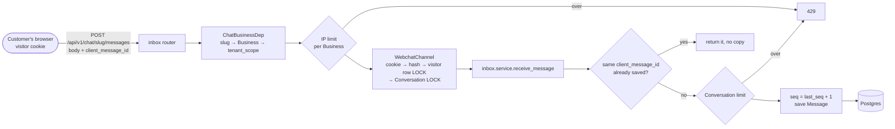
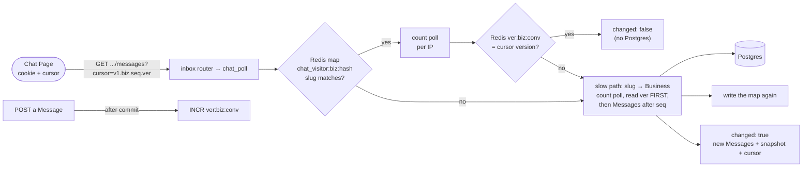
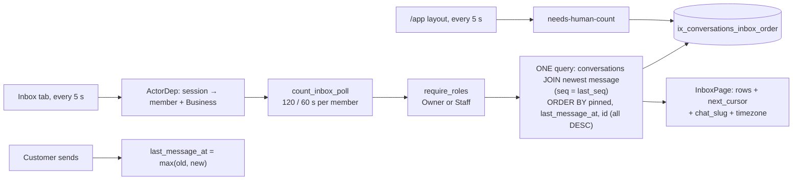
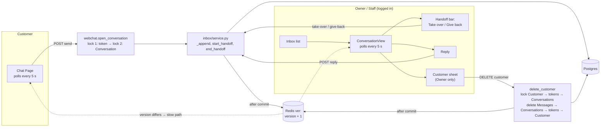

# SevaDesk architecture map (end of Epic 4, after Story 4.5)

Epic 1 built the **skeleton**: every part exists and talks to the others, but the app only says
"Namaste". Epics 2+ put real features into this skeleton.

## 1. One request, end to end (runtime)

- The **job** carries a `traceparent` label, so the worker's work joins the same trace as the request.
- `/api/health` asks Postgres, Valkey, and the worker heartbeat key. If one is missing, it answers 503.

## 2. Where the same app runs

| Place | How it starts | Postgres | TLS | Cost |
|---|---|---|---|---|
| Laptop | `docker compose up` (infra/compose) | container | Caddy, local | $0 |
| Demo (DigitalOcean droplet) | CI after every merge to main (infra/demo) | Neon (cloud) | Caddy + sslip.io | $12/month |
| AWS staging | `deploy.sh` / approved workflow (infra/terraform) | RDS | none (HTTP via ALB) | cents per hour, then `destroy.sh` |

On AWS the parts change names but keep their jobs: **ALB** = Caddy, **ECS Fargate** = the three
containers, **RDS** = Postgres, **ElastiCache** = Valkey, **Secrets Manager** holds `DATABASE_URL`.

## 3. How code reaches the world (delivery)

## 4. Safety rails built in Epic 1

| Rail | Stops what |
|---|---|
| Branch protection + CI | broken code reaching main |
| Eval harness (exit 0/1/2) | the agent's answers getting worse without anyone noticing |
| Version check after deploy | "deployed" when the old code still runs |
| PII masking in logs | phone numbers and similar data in logs |
| OIDC + approval + boundary | stolen keys; unapproved AWS changes; a role that grows into an admin |
| `check-clean.sh` + $5 budget | a forgotten AWS bill |

## 5. Epic 2: who is calling, which Business, what may they do

Epic 2 put **people** into the skeleton: sign-up, log-in, one Business per User, Roles, a team, and a theme.
Every `/api/*` request that needs a User goes through the same gates, in this order:

| Gate | Lives in | Stops what |
|---|---|---|
| Session cookie (only a hash stored) | `accounts/service.py` `resolve_session` | strangers; a leaked database giving working logins |
| Tenant scope | `core/tenancy.py`, `core/repository.py` | Owner A reading Business B's data (answers 404) |
| Roles | `accounts/permissions.py` `require_roles` | a Technician doing an Owner action (403) |
| Frontend route registry | `frontend/src/lib/pages.ts` | which /app pages exist, who may open them, the nav tabs, the settings links and the landing page; a page with no row is blocked (display only; the backend still checks) |

Per-person data (email, password hash, theme) sits on the global `users` table. Business data
(memberships, invites, and everything later) sits on tenant tables with a `business_id`.

## 6. Epic 3: the Owner sets up, the Customer gets a link

Epic 3 gave each Business something to sell, and a public door for Customers. The Owner adds
**Services** (with Prices) and **Working Hours** (plus closed days). When both exist, the Business
is "taking requests", and the Owner shares the **chat link** `/c/{chat_slug}`.

| Part | Lives in | What it guarantees |
|---|---|---|
| `businesses.chat_slug` (UNIQUE, never changes) | `business/models.py`, migration 0008 | a shared link keeps working and names one Business |
| Tenant from the slug (AD-3 b) | `business/service.py` `get_chat_page` | the public page shows only the Business the link names, whoever is logged in |
| Slug shape check before the database | `_SLUG_SHAPE` | odd links give 404, never 500 |
| Active Services only, no ids | `list_active()`, `ChatServiceOut` | Customers see only what is really for sale, and no internal ids |
| `hours_on(session, day)` | `business/service.py` | the front door Epic 5 uses for booking slots |
| Chat Page size budget (≤ 200 KB gzip) | `frontend/scripts/chat-page-size.mjs`, CI | the page stays fast on cheap phones (198.7 KB after Story 4.1: little room left) |

Two ways a tenant is chosen now: a **session cookie** (Owner and team, section 5) or a **chat slug**
(Customers, this section). Epic 4 adds the third: a **job payload** for the worker.

## 7. Epic 4: the Customer writes (Story 4.1)

A new module, **inbox**, owns 4 tenant tables: `customers`, `visitor_tokens`, `conversations`,
`messages`. A Customer has no login. Their browser gets a random **visitor cookie**; inbox stores
only a hash of it (mixed with the Business id, so one browser cannot be linked across Businesses).

| Part | Lives in | What it guarantees |
|---|---|---|
| `ChatBusinessDep` | `business/dependencies.py` | every public chat route runs inside the slug's Business; none can forget the scope |
| Channel port + webchat adapter | `inbox/channel.py`, `inbox/webchat.py` | the save logic never sees a cookie; WhatsApp later = a new adapter |
| Two locks, fixed order (visitor row, then Conversation) | `inbox/webchat.py`, `inbox/repository.py` | a double tap makes one chat; two writers never get the same `seq`; no deadlock |
| `client_message_id` (UNIQUE per Conversation) | `inbox/service.py`, `messages` table | a retry never saves a copy |
| GET writes nothing | `inbox/router.py` | the cookie is set on the first visit; the database row comes with the first send (AD-5) |
| No `conversation_id` in public routes | `inbox/schemas.py`, test | a visitor cannot ask for someone else's chat |

Tenant sources now: **session cookie** (team), **chat slug** (Customers). Epic 6 adds the **job payload**.

## 8. Epic 4: the Chat Page stays live (Story 4.2)

The page asks "anything new?" every 5 s (a **poll**). Most answers are "no", so that answer
must be cheap: it comes from Redis only, and Postgres is not touched.

| Part | Lives in | What it guarantees |
|---|---|---|
| `ver:<business_id>:<conversation_id>` (version counter) | `core/versions.py` | goes up only **after** a commit; starts at a random big number, so a lost key never matches an old cursor |
| Fast and slow paths in one module (`poll_chat`) | `inbox/chat_poll.py` | the router only passes the cookie token, cursor and IP; every poll rule (count once, cursor rule, Redis down = 503) lives in one place |
| `chat_visitor:<business_id>:<token_hash>` (the map) | `inbox/webchat.py` | written only by the slug's own slow poll, so a hit proves the Business and the Conversation |
| Order rule: version first, then Messages | `inbox/service.py` `poll_conversation` | a send that commits between the two reads is never missed: the next poll reads again |
| Cursor `v1.<business>.<after_seq>.<version>` | `inbox/schemas.py` | the browser never reads inside it; a cursor we did not make = a full poll |
| Poll limit 600 / 60 s per IP per Business | `inbox/chat_poll.py` | counted only after the map proves the Business, so a forged id makes no Redis key |
| `usePoll` | `frontend/src/api/usePoll.ts` | one loop for every live screen: 5 s, never two at once, abort at 5 s, stops when hidden |
| `chatItems` | `frontend/src/lib/chatPoll.ts` | one list sorted by `seq`: a reply shows below the Customer's own send |

Tenant sources now: **session cookie** (team), **chat slug** (Customers), and on the fast poll
the **visitor token**, proven by the map. Epic 6 adds the **job payload**.

## 9. Epic 4: the team sees every chat (Story 4.3)

| Part | Lives in | What it guarantees |
|---|---|---|
| `conversations.last_message_at` (a denormalized column) | `inbox/models.py`, migration `0010` | the sort never scans Messages; `max()` keeps it from going back when an earlier-started send saves later |
| `PINNED` = `state = 'handoff'` as fixed SQL text | `inbox/models.py` | the same expression in the index and every query, so Postgres can use the index even for a prepared query |
| `ix_conversations_inbox_order` | `inbox/models.py`, migration `0010` | one index serves the list order, the next page, and the count |
| Keyset cursor `v1.<pinned>.<microseconds>.<id>` | `inbox/schemas.py` `InboxCursor` | a new Message cannot make a row show twice or go missing between pages; the id breaks ties |
| `limit + 1` | `inbox/repository.py` `inbox_page` | one query also says "there is a next page" |
| Poll limit 120 / 60 s per member, both routes | `inbox/service.py` `count_inbox_poll` | a lockout lasts at most a minute; Redis down = 503 (fail closed) |
| `appendPage` / `mergePoll` | `frontend/src/lib/inboxList.ts` | Load more never shows a row twice; a poll never shrinks a long list |
| No poll during Load more + `signal.aborted` check | `frontend/src/components/InboxList.tsx` | an older poll answer never wipes a page that was just added |
| `useNeedsHumanCount` | `frontend/src/lib/useNeedsHumanCount.ts` | the red number on every app page; never asked for by a Technician-only User |

## 10. Epic 4 complete: reply, Handoff, and delete (Stories 4.4–4.5)

| Part | Lives in | What it guarantees |
|---|---|---|
| `start_handoff` / `end_handoff` (the only state setters) | `inbox/service.py` | one place decides who replies; a code guard test refuses state writes anywhere else |
| `_append` | `inbox/service.py` | a Customer send and a team reply number, sort and announce a Message the same way |
| `delete_customer` | `inbox/service.py` | all of a Customer's rows go in one transaction, child-first; never a half delete (NFR-8) |
| One lock order: token → Conversation | `webchat.py`, `service.py` | a send and a delete only queue, never deadlock; a test fails if the order changes |
| `ensure_and_lock` | `inbox/repository.py` | a send that waited for a row a delete removed makes it again: a new Customer, not a 500 |
| `delete_where` | `core/repository.py` | every DELETE gets the Business filter from one place |
| `manage_customer_data` (Owner only) | `accounts/permissions.py` | Staff and Technicians get 403 before any lookup, for real and fake ids alike |
| Version bump after commit | `core/versions.py` | every change (reply, Handoff, delete) wakes open screens on their next poll |

Epic 4 in one line: a Customer chats without an account, the team sees and answers every chat
live within 5 s, a person can take over from the Agent, and the Owner can erase a Customer.
Epic 5 adds Bookings; `bookings.delete_for_customer` then runs first inside `delete_customer`.
